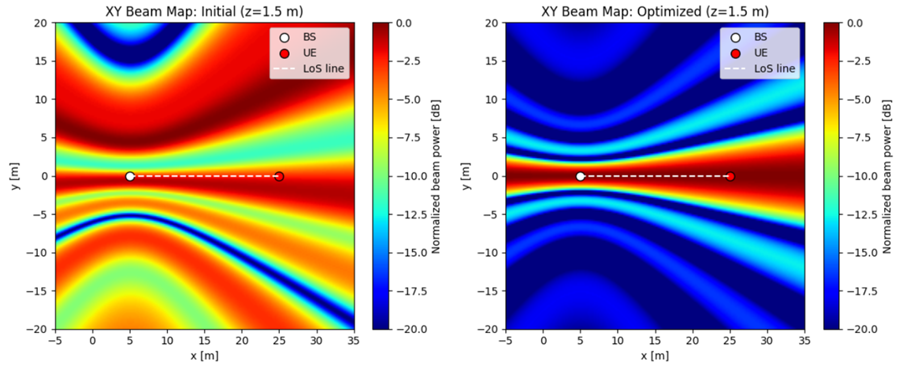

# NVIDIA Sionna — Wireless Channel Modeling & 3D Ray Tracing

**경희대학교 연구실에서 진행한 Sionna 학습 및 기본 실습을 정리한 프로젝트입니다.** Python/TensorFlow 기반의 간단한 RIS-assisted uplink 링크 시뮬레이션부터 Sionna RT의 Ray Tracing, Blender 기반 3D 건물 Scene, 일반적인 금속 반사판 유무 비교, 빔포밍 및 Radio Map 실습까지 포함합니다.

> **공개 범위:** 본 저장소는 Sionna 사용법 학습·시각화용 자료를 정리한 것입니다. 별도로 수행한 연구실의 Uplink RIS 후속 연구 코드 및 연구 데이터는 포함하지 않았습니다. 아래 **University_RIS**는 위상 제어 가능한 RIS 최적화 모델이 아니라, `metal` 재질로 설정한 **수동 반사판(passive metallic reflector)** 실습입니다.

## 1. 프로젝트 배경

MATLAB 기반의 통신 성능 분석을 보완하기 위해 3D 도시·건물 환경에서 송수신 위치, 전파 경로 및 빔포밍에 따른 신호 분포를 시각화하는 방법을 공부했습니다. 학습한 내용을 PPT로 정리하여 연구실 구성원들과 공유했습니다. 이 저장소는 실제 실습 코드와 입력 Scene 파일을 함께 정리한 버전입니다.

## 2. 주요 실습

| 구분 | 구현 또는 실습 내용 | 시작 파일 |
| --- | --- | --- |
| **Ray Tracing (Munich)** | 28 GHz 도시 환경, UE/BS 배치, 직접파 및 반사 경로 계산·시각화 | `scripts/rt_visualize.py`, `notebooks/01_rt_visualize.ipynb` |
| **Blender Scene 불러오기** | Blender로 구성한 3D 건물 Scene의 XML 및 PLY Mesh 로딩 | `notebooks/02_load_blender_scene.ipynb` |
| **학교 건물 + 금속 반사판** | 반사판 없는 환경과 금속 반사판이 추가된 환경의 경로/수신 특성 비교 | `notebooks/03_university_reflector_comparison.ipynb` |
| **Uplink 기초 링크** | Rayleigh fading, 단일 사용자 SIMO, 위상 기반 RIS 계수, QPSK, MRC, BER 및 평균 Rate | `scripts/uplink_sim.py` |
| **Downlink Radio Map** | 외부 MATLAB 채널·빔포밍 벡터를 불러와 공간별 신호 분포 비교 | `notebooks/05_downlink_radio_map_external_mat.ipynb` (**별도 .mat 필요**) |
| **예전 버전 호환 실습** | 구버전 Sionna RT의 RIS 객체 import 확인 | `notebooks/04_legacy_sionna019_import.ipynb` |

### 대표 결과 이미지 — Radio Map



*무선통신 시뮬레이션을 통해 생성한 공간별 신호 분포 예시입니다. 실제 상용 기지국의 측정 결과가 아닙니다.*

## 3. 디렉터리 구조

```text
Sionna_Project_GitHub_Complete/
├── README.md
├── .gitignore
├── scripts/
│   ├── rt_visualize.py             # Sionna RT Munich 시각화
│   └── uplink_sim.py               # TF-only uplink SIMO / RIS 예제
├── notebooks/
│   ├── 01_rt_visualize.ipynb
│   ├── 02_load_blender_scene.ipynb
│   ├── 03_university_reflector_comparison.ipynb
│   ├── 04_legacy_sionna019_import.ipynb
│   ├── 05_downlink_radio_map_external_mat.ipynb
│   └── experiments/                # 실험 중 작성한 탐색용 notebook
├── scenes/
│   ├── University.xml              # 학교 건물, 반사판 없음
│   ├── University_RIS.xml          # 학교 건물, 금속 반사판 있음
│   ├── library.xml                 # 다른 건물 예제 Scene
│   └── meshes/                    # XML에서 참조하는 PLY Mesh 전체
├── models/                         # 원본 Blender 및 X3D 파일
├── osm/                            # 건물 지도/OSM 원천 파일 전체
├── figures/                        # RT 시각화 결과 이미지
├── data/README.md                  # 별도 입력 .mat 파일 안내
└── docs/FILE_MANIFEST.md          # 원본-정리본 파일명 대응표
```

`University.xml`과 `University_RIS.xml`의 `meshes/*.ply` 참조 경로를 보존하기 위해 해당 XML과 `meshes` 폴더는 반드시 **같은 `scenes/` 폴더 아래의 구조 그대로** 유지해야 합니다.

## 4. 실행 순서

**준비:** Python, Jupyter Notebook, NVIDIA Sionna/Sionna RT, TensorFlow, NumPy, Mitsuba, SciPy, Pillow 등 실습별 필요한 패키지를 설치합니다. 이 자료는 작성 시점의 서로 다른 Sionna API/버전을 포함하므로, 하나의 버전에서 모든 파일을 무조건 실행할 수 있다고 보장하지 않습니다. 실제 사용한 환경에 맞춰 공식 설치 지침과 코드 API를 확인해 주세요.

1. 저장소를 내려받고 **저장소 최상위 폴더**에서 터미널/Jupyter를 실행합니다.
2. 먼저 `python scripts/rt_visualize.py`를 실행하여 기본 Munich 환경에서 전파 경로를 계산하고 `figures/rt_paths_script.png`를 생성합니다.
3. `jupyter lab`을 실행하고 `notebooks/01_rt_visualize.ipynb`를 열어 카메라 및 전파 경로를 시각화합니다.
4. `notebooks/02_load_blender_scene.ipynb`로 `scenes/library.xml` 불러오기를 확인합니다.
5. `notebooks/03_university_reflector_comparison.ipynb`의 셀을 차례대로 실행하여 학교 건물 Scene 및 수동 금속 반사판 유무를 비교합니다.
6. 별도로 `python scripts/uplink_sim.py`를 실행하면 **Sionna RT가 아닌 TensorFlow 자체 링크 시뮬레이션**으로 BER/Rate를 계산합니다.

> `notebooks/04_legacy_sionna019_import.ipynb`는 과거 버전 테스트에 해당하므로 별도 버전 환경에서 확인해야 할 수 있습니다. `notebooks/05_downlink_radio_map_external_mat.ipynb`는 `data/Beamforming_1User_Init_Opt.mat`가 없으면 실행할 수 없습니다. 입력 파일은 본 저장소에 포함되어 있지 않습니다.

## 5. Scene 및 반사판에 대한 설명

- `scenes/University.xml`: PLY 형식으로 내보낸 학교 건물의 외벽과 지붕에 `concrete` 재질 적용
- `scenes/University_RIS.xml`: 위 모델에 `scenes/meshes/RIS_panel.ply`를 추가하고 `metal` 재질 적용
- `models/University.blend`: Blender 원본 3D 장면
- `models/library.blend`, `scenes/library.xml`: 별도로 구성한 기본 건물 장면 및 변환 결과
- `osm/`: Blender 모델링에 사용·생성한 지도 소스 모음

**주의:** 노트북 및 파일 이름에 `RIS`가 포함되어 있어도 이 반사판 비교 실습은 **능동 소자, 프로그래머블 위상 응답, RIS 최적화 알고리즘**을 구현했다고 볼 수 없습니다. 메탈 패널에 따른 경로 변화 및 성능 비교 수준으로 기술하는 것이 정확합니다.

## 6. Notebook / 코드별 설명

| 파일 | 설명 / 주의사항 |
| --- | --- |
| `01_rt_visualize.ipynb` | 내장 Munich 장면의 송수신 위치 설정, PathSolver 경로 계산, 3D 이미지 저장 |
| `02_load_blender_scene.ipynb` | Mitsuba/Sionna 로딩 확인 및 `library.xml` 미리보기 |
| `03_university_reflector_comparison.ipynb` | 학교 Scene 2종의 경로 및 SVD 기반 빔포밍 비교 학습 |
| `04_legacy_sionna019_import.ipynb` | 이전 버전 RIS API import 테스트; 구버전 환경 필요할 수 있음 |
| `05_downlink_radio_map_external_mat.ipynb` | `.mat`의 `h`, `w_init`, `w_opt`, `info`를 사용; **원본 프로젝트 압축파일에도 데이터 없음** |
| `experiments/reflector_development_notes.ipynb` | 반사판 재질/위치/시각화 관련 탐색적 실험; 셀 간 변수 의존 가능 |
| `experiments/downlink_radio_map_draft.ipynb` | Radio Map 초기 실험의 별도 초안; 외부 `.mat` 필요 |
| `scripts/uplink_sim.py` | 순수 TensorFlow 기반, Sionna PHY/RT 호출 없음 |

원본 Notebook의 저장된 출력에는 과거 PC 경로가 포함되어 있어 **실행 결과 캐시를 제거**했습니다. 대표 이미지는 `figures/`에 별도로 보존했습니다. 또한 옛 Windows 절대경로는 프로젝트 상대경로로 교체했습니다. 시뮬레이션 알고리즘 자체의 정확성을 새로 검증하거나 성능을 재현한 것은 아닙니다.

## 7. 출처 및 라이선스 (References & Licenses)

본 프로젝트는 무선통신 시뮬레이션 학습 및 실습을 목적으로 제작되었으며, 다음 오픈소스 소프트웨어와 공개 데이터를 활용하였습니다.

- **NVIDIA Sionna:** https://nvlabs.github.io/sionna/ (Apache License 2.0)
- **Blender:** https://www.blender.org/
- **OpenStreetMap:** https://www.openstreetmap.org/copyright (© OpenStreetMap contributors, ODbL 1.0)

본 저장소에는 Python 기반 시뮬레이션 코드, Blender를 활용한 3D 환경 모델, OpenStreetMap 기반 지도 데이터 및 전파환경 분석 결과가 포함되어 있습니다.

외부 소프트웨어와 지도 데이터, 3D 모델 등의 저작권 및 라이선스는 각 원저작자와 제공자의 조건을 따릅니다. 제3자 자료의 재배포 가능 여부는 개별 파일의 출처 및 적용 라이선스를 기준으로 확인해야 합니다.

본 저장소는 공개 가능한 학습 및 기본 실습자료를 중심으로 구성하였으며, 별도로 수행한 연구실의 비공개 연구 코드와 데이터는 포함하지 않았습니다.
